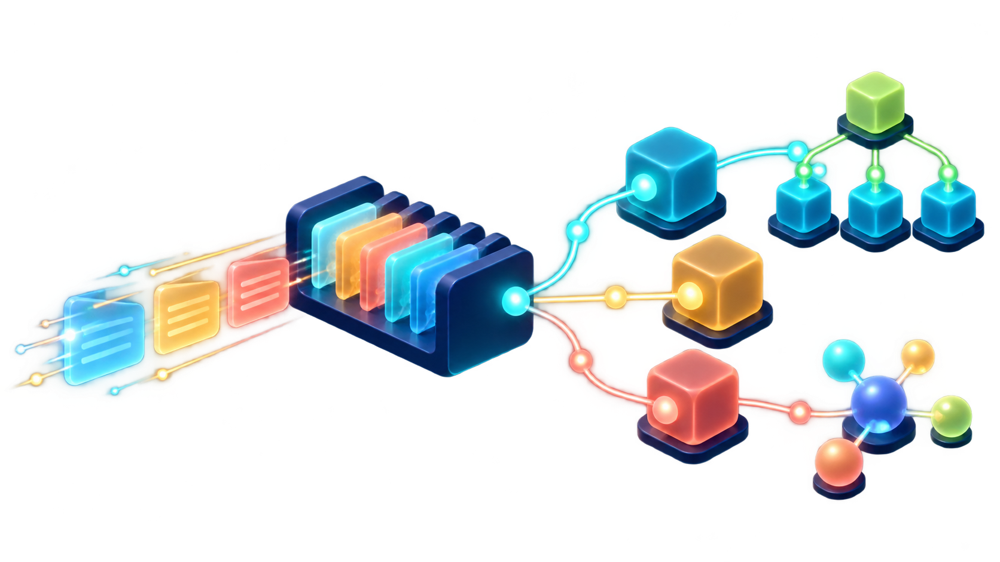
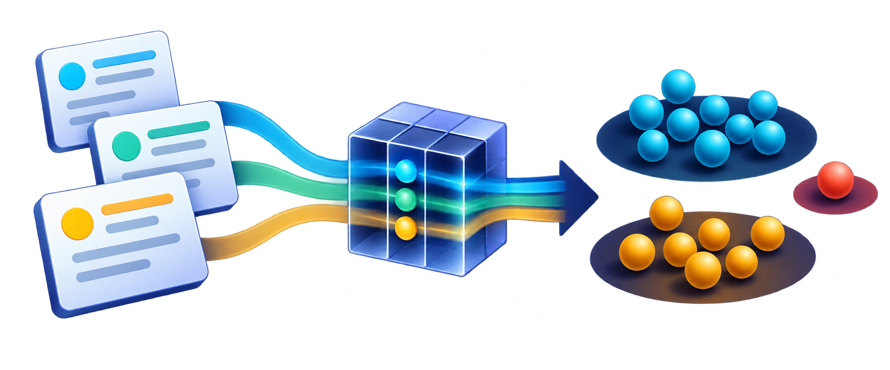

# Oficina: estruturas de dados na prática

  

  <strong>Do problema de software à estrutura que ajuda a resolvê-lo.</strong> 
  Exemplos executáveis em Java e Python, com dados fictícios e explicações passo a passo.

  ☕ Java 17+ &nbsp;·&nbsp; 🐍 Python 3.10–3.13 &nbsp;·&nbsp; 🧩 10 exemplos práticos &nbsp;·&nbsp; 📚 Bibliotecas reais

> **Proposta da oficina:** usar estruturas e algoritmos disponíveis nas bibliotecas do ecossistema. A turma acompanha os dados, observa as operações e discute por que cada escolha faz sentido — sem reimplementar listas, filas, mapas, grafos, cosseno ou HDBSCAN à mão.

  <a href="#visao-geral">Visão geral</a> ·
  <a href="#comece-aqui">Comece aqui</a> ·
  <a href="#mapa-dos-exemplos">Exemplos</a> ·
  <a href="#hdbscan-por-dentro">HDBSCAN por dentro</a> ·
  <a href="#documentacao-do-projeto">Documentação</a>

## 🧭 Visão geral

A oficina parte de situações comuns no desenvolvimento de sistemas: priorizar chamados, processar pedidos, desfazer configurações, consultar logs, mapear dependências e recuperar artigos de suporte. Cada cenário destaca uma necessidade concreta e mostra como a estrutura escolhida muda a forma de consultar ou processar os dados.

O fluxo de aprendizagem é o mesmo em cada exemplo:

~~~mermaid
flowchart LR
    A["Problema do dia a dia"] --> B["Modelar os dados"]
    B --> C["Escolher uma estrutura pronta"]
    C --> D["Executar a operação necessária"]
    D --> E["Ler e discutir o resultado"]
~~~

Em Java, os exemplos usam coleções do JDK e JGraphT. Em Python, mostram similaridade por cosseno, recuperação de documentos com TF-IDF e a sequência de estruturas usada pelo HDBSCAN. O último exemplo abre as etapas do algoritmo e também executa a API completa da biblioteca para comparação.

**Para quem:** estudantes com conhecimentos básicos de lógica e pessoas que querem relacionar estruturas de dados a decisões de desenvolvimento de software.

## 🚀 Comece aqui

### Pré-requisitos

- **JDK 17 ou superior**
- **Python 3.10 a 3.13**; Python 3.13 é recomendado
- **macOS ou Linux** para os scripts abaixo. Há comandos equivalentes para Windows mais adiante.

Na raiz do projeto, prepare as dependências e abra o menu:

~~~sh
sh preparar.sh
sh executar.sh
~~~

A preparação cria ou reutiliza o ambiente local <code>.venv</code>, instala as versões definidas em <a href="requirements.txt">requirements.txt</a> e baixa as dependências Java para <code>lib/</code>: JGraphT 1.5.2 e suas dependências, além do JUnit 5.11.4 (Console Standalone 1.11.4), usado somente nos testes. Ela procura <code>python3.13</code>, <code>python3.12</code>, <code>python3.11</code>, <code>python3.10</code> e, por fim, <code>python3</code>. Não é necessário que o comando <code>python</code> exista.

~~~sh
# Escolher explicitamente o interpretador usado na preparação
OFICINA_PYTHON=python3.13 sh preparar.sh
~~~

> A preparação precisa de internet para baixar pacotes. Depois dela, os exemplos executam localmente e não acessam serviços externos, nuvem ou APIs.

### Executar os exemplos

No menu, escolha um número de **1 a 10**, <code>todos</code> para percorrer a oficina ou <code>0</code> para sair. Cada exemplo cria os próprios dados e pode ser repetido em qualquer ordem.

~~~sh
# Abrir o menu interativo
sh executar.sh

# Rodar todos os exemplos
sh executar.sh todos

# Rodar um exemplo Java pelo número
sh executar.sh 1

# Rodar os exemplos Python pelo menu
sh executar.sh cosseno
sh executar.sh rag
sh executar.sh hdbscan
~~~

### Saída colorida e legível

Os logs usam títulos, etapas, recuos e marcas visuais para separar contexto, entrada, processamento, resultado e observações. Em terminais compatíveis, as cores ANSI são ativadas automaticamente.

~~~sh
OFICINA_CORES=sempre sh executar.sh   # Forçar cores
OFICINA_CORES=nunca sh executar.sh   # Desativar cores
NO_COLOR=1 sh executar.sh            # Desativar cores automaticamente
~~~

Quando a saída é redirecionada para arquivo ou pipe, as cores são desligadas por padrão para manter o texto limpo.

## 🗺️ Mapa dos exemplos

| # | Cenário de software | Estruturas e operações em foco | O que observar |
| --- | --- | --- | --- |
| **1 · Java** | Priorizar bugs para o plantão | <code>List</code>, Streams, <code>EnumMap</code>, <code>PriorityQueue</code> | Ordenar o trabalho sem alterar a lista original. |
| **2 · Java** | Liberar pedidos pagos para separação | <code>Queue</code>/<code>ArrayDeque</code>, <code>HashSet</code>, <code>Optional</code> | Ordem FIFO, deduplicação e estados do pedido. |
| **3 · Java** | Desfazer ajustes de configuração | <code>Deque</code> e snapshots imutáveis | Histórico LIFO que restaura um estado anterior. |
| **4 · Java** | Consultar usuários pelo identificador | <code>HashMap</code>, <code>Optional</code> e Streams | Busca por chave e tratamento explícito da ausência. |
| **5 · Java** | Investigar logs em um intervalo de tempo | <code>TreeMap</code>, <code>subMap</code>, <code>flatMap</code> | Consultar uma faixa temporal e preservar timestamps repetidos. |
| **6 · Java** | Descobrir o impacto de uma falha entre serviços | Grafo direcionado JGraphT, BFS e DFS | Seguir a direção das dependências e encontrar equipes afetadas. |
| **7 · Python** | Comparar volumes por área | Arrays NumPy e <code>cosine_similarity</code> | Distinguir semelhança de perfil de volume absoluto. |
| **8 · Java** | Processar pagamentos com repetição e falha | <code>ArrayBlockingQueue</code>, <code>HashMap</code>, <code>HashSet</code> | Capacidade limitada, idempotência local e fila de análise. |
| **9 · Python** | Recuperar artigos para compor contexto de RAG | TF-IDF, matriz esparsa CSR, cosseno e ranking | Inspecionar quais documentos ajudam a responder uma consulta. |
| **10 · Python** | Agrupar incidentes semelhantes e identificar ruído | KDTree, matrizes, CSR, MST, union-find e árvore condensada | Abrir a sequência de dados intermediários do HDBSCAN e comparar com a API completa. |

Os cenários Java usam objetos de domínio e regras de aplicação. Eles demonstram validações, imutabilidade, <code>Objects.requireNonNull</code>, <code>Comparator</code>, referências de método, <code>BigDecimal</code> para valores, <code>Instant</code>/<code>Duration</code> para tempo, Streams para consultas e <code>Optional</code> para retornos que podem estar ausentes. Métodos explícitos tratam as operações que alteram estado.

## 🎓 Como estudar cada exemplo

Para cada cenário, pergunte:

1. **Qual operação o sistema precisa fazer?** Buscar por chave, manter ordem, consultar uma faixa, priorizar ou percorrer relações?
2. **Que estrutura favorece essa operação?** Considere custo, ordenação, repetição, acesso e mutabilidade.
3. **Como a entrada se transforma?** Acompanhe o estado antes e depois da operação.
4. **O que significa a saída?** Relacione o resultado ao problema do cenário e discuta seus limites.
5. **O que seria diferente com outra estrutura?** Compare a semântica e os custos, sem escolher uma estrutura só porque ela é familiar.

### Roteiro sugerido para uma apresentação de aproximadamente 110 minutos

| Tempo | Exemplos | Foco |
| --- | --- | --- |
| 5 min | Abertura | Apresentar os cenários e a ideia de escolher pela operação necessária. |
| 15 min | 1–3 | Prioridade, fila FIFO e histórico LIFO. |
| 15 min | 4–5 | Busca por chave, ausência com <code>Optional</code> e consulta temporal. |
| 10 min | 6 | Direção do grafo, BFS/DFS e impacto. |
| 10 min | 7 | Vetores, cosseno e interpretação dos escores. |
| 10 min | 8 | Fila limitada, repetição, falhas e contadores. |
| 10 min | 9 | Matriz TF-IDF esparsa e recuperação de contexto. |
| 25 min | 10 | Estruturas intermediárias do HDBSCAN e comparação com a API pública. |

## 🔬 HDBSCAN por dentro

O exemplo usa **nove incidentes fictícios no estilo ServiceNow**. Cada incidente contém número, grupo de atendimento, resumo, horas para resolução e usuários afetados. Somente as **duas features numéricas** — horas e usuários — entram no agrupamento. Número, grupo e resumo permanecem visíveis para ajudar a interpretar os grupos depois.

A imagem destaca essa transformação: registros com medidas comparáveis são convertidos em pontos, e pontos próximos formam agrupamentos.

  

<em>Os registros viram pontos comparáveis; o algoritmo encontra regiões densas e identifica o ponto isolado.</em>

O diagrama mostra a ordem das transformações. Cada estrutura prepara a informação que a etapa seguinte precisa:

~~~mermaid
flowchart LR
    A["Incidentes fictícios"] --> B["Selecionar horas e usuários afetados"]
    B --> C["StandardScaler e matriz de pontos"]
    C --> D["Distâncias e core distances"]
    D --> E["Alcançabilidade mútua"]
    E --> F["Grafo CSR e árvore geradora mínima"]
    F --> G["Hierarquia linkage"]
    G --> H["Árvore condensada"]
    H --> I["Estabilidade e seleção EOM"]
    I --> J["Rótulos: grupos ou ruído"]
    J --> K["Comparar com HDBSCAN.fit"]
~~~

### Etapas e estruturas observadas

| Etapa | Entrada → saída observável | Por que essa estrutura aparece agora |
| --- | --- | --- |
| **1 · Preparar os pontos** | Objetos <code>Incidente</code> → <code>ndarray (9, 2)</code> padronizado | A matriz numérica oferece às rotinas de distância uma representação consistente. Padronizar evita que a unidade ou a escala de uma feature domine a outra. |
| **2 · Medir distâncias** | Pontos → <code>ndarray (9, 9)</code> | A matriz registra a distância entre cada par. Ela permite inspecionar proximidade antes de calcular densidade. |
| **3 · Estimar densidade local** | KDTree, índices de vizinhos e vetor de core distances | A KDTree organiza pontos para consultar vizinhos. A distância ao vizinho de referência estima o quanto cada ponto está isolado. É uma estrutura auxiliar de inspeção nesta oficina. |
| **4 · Ajustar distâncias pela densidade** | Matriz de pesos e grafo esparso CSR (<code>indptr</code>, <code>indices</code>, <code>data</code>) | A alcançabilidade mútua incorpora a densidade local às distâncias. O grafo representa as conexões ponderadas usadas na construção da hierarquia. |
| **5 · Preservar as conexões essenciais** | Grafo → MST e array de oito arestas | A árvore geradora mínima conecta os pontos com peso total mínimo. Para a hierarquia de conectividade, ela conserva as ligações essenciais sem carregar todas as arestas na etapa seguinte. |
| **6 · Construir as fusões** | Arestas ordenadas → linkage <code>(8, 4)</code> e componentes | O linkage registra, em ordem, quais componentes se unem e em que distância. A inspeção com <code>DisjointSet</code> ajuda a visualizar as uniões. |
| **7 · Condensar a hierarquia** | Linkage → registros <code>parent/child/lambda_val/child_size</code> e estabilidade por grupo | A árvore condensada aplica o tamanho mínimo e acompanha quais grupos persistem conforme a densidade muda. Isso prepara a seleção de clusters. |
| **8 · Selecionar o resultado** | Estabilidades → vetor de rótulos | A seleção EOM escolhe grupos estáveis na árvore. O rótulo <code>-1</code> identifica pontos tratados como ruído. |
| **9 · Conferir a API completa** | Mesmos pontos → comparação de rótulos, forças de pertencimento e persistências | A chamada pública <code>HDBSCAN.fit</code> mostra o resultado integrado da biblioteca e permite conferir o percurso aberto com os mesmos parâmetros. |

### O que cada etapa usa

| Etapa | Funções/bibliotecas observadas |
| --- | --- |
| 1 | <code>dataclass</code>, <code>numpy.array</code>, <code>StandardScaler</code> do scikit-learn |
| 2 | <code>pairwise_distances</code> do scikit-learn |
| 3 | <code>KDTree.query</code> e <code>KDTree.get_arrays</code> |
| 4 | Rotina interna <code>hdbscan.mutual_reachability</code> e <code>scipy.sparse.csr_matrix</code> |
| 5 | <code>scipy.sparse.csgraph.minimum_spanning_tree</code> |
| 6 | Rotina interna de linkage do HDBSCAN; <code>scipy.cluster.hierarchy.DisjointSet</code> para acompanhar as uniões |
| 7 | Rotinas internas <code>condense_tree</code>, <code>compute_stability</code> e <code>get_clusters</code> |
| 8 | Seleção EOM realizada pela biblioteca |
| 9 | API pública <code>hdbscan.HDBSCAN.fit</code> |

**Uma distinção importante:** a consulta à KDTree expõe vizinhos e core distances para a turma. A rotina interna de alcançabilidade mútua calcula seus core distances durante a própria chamada; a consulta separada é uma inspeção, não uma alteração oculta do cálculo. Da mesma forma, <code>DisjointSet</code> acompanha visualmente as arestas da MST; a biblioteca continua responsável por construir o linkage.

### Resultado padrão e comparação

Com <code>min_samples=2</code> e <code>min_cluster_size=3</code>, a demonstração forma dois grupos de quatro incidentes e deixa um incidente como ruído:

- **Grupo 0:** INC0010451–INC0010454
- **Grupo 1:** INC0010521–INC0010524
- **Ruído:** INC0010899, identificado pelo rótulo <code>-1</code>

A etapa 9 executa a API completa com <code>algorithm="generic"</code> e MST exata, alinhando a comparação ao caminho dissecado. Para este conjunto e estes parâmetros, a partição, as forças de pertencimento e as persistências coincidem. Os números dos grupos podem ser trocados sem mudar a partição: o rótulo 0 não significa que um grupo seja “melhor” que o outro. <code>probabilities_</code> representa força de pertencimento ao cluster, não uma probabilidade calibrada.

### Parâmetros para experimentar

O padrão é <code>min_samples=2</code> e <code>min_cluster_size=3</code>. Na biblioteca <code>hdbscan</code>, <code>min_samples</code> conta vizinhos externos, sem incluir o próprio ponto. A consulta de inspeção à KDTree usa <code>k=min_samples+1</code> para incluir o ponto consultado.

~~~sh
# O detalhamento já é o padrão
sh executar.sh hdbscan

# Exibir uma etapa específica (1 a 8) ou apenas a comparação (9)
sh executar.sh hdbscan --etapa 4
sh executar.sh hdbscan --etapa 9

# Ajustar os parâmetros e ver o resumo
sh executar.sh hdbscan --min-samples 3
sh executar.sh hdbscan --min-cluster-size 5 --resumo
~~~

<code>min_samples</code> aceita valores de 1 a 8; <code>min_cluster_size</code>, de 2 a 9. Mais vizinhos podem tornar o critério de densidade mais conservador, mas não garantem uma mudança monotônica no número de grupos. O tamanho mínimo determina quais ramos podem ser considerados clusters.

Para acompanhar as perguntas, contas de estabilidade e leitura detalhada das estruturas, consulte o [roteiro de HDBSCAN](docs/roteiro-hdbscan.md). As dependências entre exemplos também estão registradas na [saída esperada completa](docs/saida-esperada.txt).

## 🧰 Comandos de referência

### Python sem passar pelo menu Java

~~~sh
.venv/bin/python python/oficina.py cosseno
.venv/bin/python python/oficina.py rag
.venv/bin/python python/oficina.py hdbscan
.venv/bin/python python/oficina.py hdbscan --etapa 5
.venv/bin/python python/oficina.py hdbscan --min-samples 3 --resumo
~~~

No Windows, use <code>.venv\Scripts\python.exe</code> no lugar de <code>.venv/bin/python</code>. O menu procura o Python em <code>.venv</code>; para usar outro interpretador com as dependências instaladas, defina <code>OFICINA_PYTHON</code>.

### Compilação Java manual

Na raiz do projeto, no macOS/Linux:

~~~sh
javac --release 17 -encoding UTF-8 -cp 'lib/*' -d out @fontes.txt
java -Dfile.encoding=UTF-8 -cp 'out:lib/*' oficina.Main
~~~

No Windows, após preparar as dependências:

~~~powershell
py -3.13 preparar.py
javac --release 17 -encoding UTF-8 -cp "lib/*" -d out "@fontes.txt"
java -Dfile.encoding=UTF-8 -cp "out;lib/*" oficina.Main
~~~

### Verificação automatizada

Para compilar com avisos tratados como erros, executar os testes Java e verificar a integração com os exemplos Python:

~~~sh
sh verificar.sh
~~~

Os testes cobrem regras de domínio, validações, transições, consultas, direção de grafos, processamento de eventos, opções do menu, estruturas intermediárias do HDBSCAN e comparação com a API completa. Eles verificam os exemplos e sua integração; não substituem nem reimplementam os algoritmos das bibliotecas.

<strong>Comandos de verificação no Windows</strong>

~~~powershell
javac --release 17 -encoding UTF-8 -cp "out;lib/*" -d out-testes "@fontes-testes.txt"
java -cp "out;out-testes;lib/*" org.junit.platform.console.ConsoleLauncher execute --scan-class-path=out-testes --disable-banner --fail-if-no-tests
.venv\Scripts\python.exe -m unittest discover -s testes -p "test_*.py" -v
~~~

## 🧱 Estrutura do projeto

~~~text
.
├── src/oficina/
│   ├── dominio/          # Objetos, validações e estados
│   ├── casos/            # Regras de aplicação
│   └── demonstracoes/    # Cenários e apresentação no terminal
├── python/               # Cosseno, RAG e HDBSCAN dissecado
├── testes/               # Testes Java e Python
├── docs/
│   ├── assets/           # Ilustrações desta oficina
│   ├── apresentacao-minicurso-estruturas.html
│   ├── apresentacao-minicurso-estruturas.pptx
│   ├── roteiro-java.md
│   ├── roteiro-hdbscan.md
│   ├── roteiro-fala-minicurso.md
│   └── saida-esperada.txt
├── preparar.sh
├── executar.sh
└── verificar.sh
~~~

Os diretórios <code>.venv/</code>, <code>out/</code> e os JARs em <code>lib/</code> são criados ou preparados para executar e verificar o projeto. Os cenários Java estão em <a href="src/oficina/demonstracoes/ExemplosColecoes.java">ExemplosColecoes.java</a> e <a href="src/oficina/demonstracoes/ProcessamentoEventos.java">ProcessamentoEventos.java</a>. <a href="src/oficina/demonstracoes/ExemplosPython.java">ExemplosPython.java</a> apenas inicia os processos Python; os cálculos de similaridade e agrupamento ocorrem em Python.

## 📖 Documentação do projeto

- [Roteiro Java](docs/roteiro-java.md) — conceitos, ordem de apresentação e decisões dos exemplos Java.
- [Roteiro HDBSCAN](docs/roteiro-hdbscan.md) — estruturas intermediárias, perguntas para a turma e contas de estabilidade.
- [Roteiro de fala](docs/roteiro-fala-minicurso.md) — apoio para conduzir a apresentação.
- [Apresentação visual em HTML](docs/apresentacao-minicurso-estruturas.html).
- [Apresentação em PowerPoint](docs/apresentacao-minicurso-estruturas.pptx).
- [Saída esperada](docs/saida-esperada.txt) — referência completa de <code>sh executar.sh todos</code>.

## ⚖️ Limites, complexidade e decisões de modelagem

<strong>Abra para consultar custos e limites de cada demonstração</strong>

### Custos aproximados

| Estrutura/operação | Custo esperado |
| --- | --- |
| <code>ArrayList</code> | Acesso por índice O(1); inclusão ao final O(1) amortizado; busca e remoção no meio O(n). |
| <code>ArrayDeque</code> | Operações nas pontas O(1) amortizado. |
| <code>PriorityQueue</code> | Consultar a cabeça O(1); inserir e remover o próximo item O(log n). |
| <code>HashMap</code> | Busca e atualização O(1) esperado com boa distribuição de chaves; não garante ordem. |
| <code>TreeMap</code> | Busca, inclusão e remoção O(log n); consulta temporal O(log t + k), com t timestamps e k registros retornados. |
| BFS/DFS | O(V + E), com V vértices e E arestas. |
| Cosseno denso | Comparar um perfil com N perfis de d dimensões: O(N·d). Ordenar N escores acrescenta O(N log N). |
| HDBSCAN desta oficina | Matriz completa: O(n²) de espaço e busca de distâncias O(n²·d). O conjunto pequeno serve para inspecionar estruturas, não para medir desempenho. |

### Limites dos cenários

- **Coleções e grafos:** as APIs são prontas. <code>TreeMap</code> demonstra ordenação e consulta por faixa, mas não expõe nós para percursos pré/pós-ordem. O grafo direcionado representa dependências de fornecedor para consumidor e impacto potencial; não modela redundância nem contingência. A ordem dos vizinhos influencia a ordem observada no BFS/DFS.
- **Persistência e concorrência:** repositórios, históricos e índices existem só em memória. Os exemplos de aplicação rodam em uma thread. Pedidos não modelam frete, impostos, cancelamentos ou pagamentos parciais; filas e IDs não têm expiração ou armazenamento persistente.
- **Eventos:** produtor e consumidor se alternam em uma thread. A fila tem capacidade três; evento 401 chega duas vezes e o <code>HashSet</code> evita reaplicar o pagamento. Evento 404 aponta para pedido inexistente e vai para análise. Não há broker, rede, retentativa automática, persistência ou transação distribuída; a simulação não garante entrega exatamente uma vez.
- **Cosseno:** os vetores de contagem são fictícios e não negativos. Cosseno compara a direção relativa dos vetores, não o volume absoluto nem a relevância factual. Features centralizadas podem gerar escores negativos.
- **Recuperação para RAG:** TF-IDF e matriz CSR são gerados localmente. A busca compara todos os artigos e ordena os escores. Não há embeddings semânticos, índice vetorial aproximado nem geração de resposta; o índice é reconstruído na inicialização.
- **HDBSCAN:** usa distância euclidiana, <code>alpha=1</code>, seleção EOM e raiz excluída. A matriz completa e o grafo denso não são adequados a bases grandes. As funções internas de <code>hdbscan</code> usadas para abrir as etapas podem mudar entre versões, que por isso ficam fixadas. O exemplo não prevê novas amostras. IDs da árvore condensada, do linkage e dos rótulos são conceitos diferentes; empates podem aparecer como fusões binárias na mesma distância.

## 🔗 Referências

- [Documentação de <code>cosine_similarity</code>](https://scikit-learn.org/stable/modules/generated/sklearn.metrics.pairwise.cosine_similarity.html)
- [Documentação de <code>TfidfVectorizer</code>](https://scikit-learn.org/1.7/modules/generated/sklearn.feature_extraction.text.TfidfVectorizer.html)
- [Código de linkage do HDBSCAN](https://github.com/scikit-learn-contrib/hdbscan/blob/master/hdbscan/_hdbscan_linkage.pyx)

  Oficina didática com dados fictícios • Java e Python • Estruturas de dados em contexto

